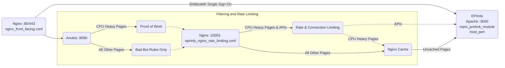

# BEVIS: Bot Exclusion and Velocity Inhibitor System

**This is still experimental and targetted at EPrints Services hosting infrastructure, use at your own risk**


Named after Southampton's legendary local hero, [Sir Bevis of Hampton](https://en.wikipedia.org/wiki/Bevis_of_Hampton), BEVIS is a combination of open source tools to improve uptime and responsiveness of EPrints on the modern AI-bot filled web. BEVIS:
 - Replaces Apache with Nginx for the front facing server
 - Adds Anubis to (attempt to) filter out bots
 - Adds a cache
 - Rate limits the most CPU intensive requests (primarily search)
 - Optimises the Apache configuration for EPrints to increase stability


Our aim is for EPrints to accessible to well behaved bots, while remaining online with high uptime. Blocking and rate limiting the badly behaved bots is unfortunatly necessary for EPrints to remain responsive.

## Anubis Bot Filtering

[Anubis](https://anubis.techaro.lol/) is an open source project which attempts to block badly behaved web scrapers. It behaves as a reverse proxy, deciding whether to forward on requests to the service being protected or block them. EPrints is susceptible to being taken offline by swarms of AI bots which are indistinguishable from a DDOS attack. The CPU heavy search and statistics pages can very easily be overwhelmed and take an entire repository offline.

The default configuration aims to reach a balance between being as open as possible - we should like to allow well behaved scrapers to index EPrints - but blocking the worst bots to prioritise staying online.

Shibboleth logins are supported. Multiple repositories on the same host are theoretically supported, but untested.

## Rate Limiting and Caching With Nginx

Even with Anubis configured some repositories have still experienced extremely heavy CPU load and been taken offline. Rate and connection limiting requests, and caching config for nginx further reduces CPU usage and improves reliability. This enables a cache for non-logged in users accessing CPU heavy pages, and also limits for requests per IP and overall.

The caching should be able to make a significant improvement in response times when under heavy load from some of the stranger bot swarms which make thousands of identical requests. In order to support caching, some minor changes are required to how EPrints uses cookies to store login sessions. The fixes are contained in z_fix_cookies.pl.disabled and this should be symlinked into the archive until this is fixed in EPrints core - hopefully in EPrints 3.4.8. You will also need to create the folder structure for the cache, and configure it in selinux. The idea behind having the cache folders owned and writable by the eprints user is so we could easily add admin tools for clearing the cache, if required.

Nginx replaces Apache as the front facing web server because it supports more connections, while using less CPU and RAM.

Nginx also listens on port 10001, behind Anubis and in front of EPrints. It will limit rates globally and per-IP and limit the maximum number of simultanious connections to CPU heavy pages (configurable). When limits have been reached, an HTTP 503 is sent, with a page explaining which feature is temporarily offline. This should keep a lid on the maximum CPU usage and enable EPrints to stay alive, even if search, stats, and export functionality stops working.  The default configuration is intended to allow all connections through under normal load, and start blocking connections (responding with a page saying "[repo name] is under heavy load and this feature is temporarily unavailable. Please try again later.") only when necessary to keep the server online and responding in a timely manner to other requests. In practice, the caching handles much of the strange DDOS like bot traffic without rate limiting being used.

## Apache Optimised for EPrints

EPrints is still unstable using mpm_event, reducing the maximum number of simultaneous requests it can support. Using mpm_prefork it is stable, and the caching and filtering from Nginx appears to be sufficient to still serve enough requests in a timely fashion.

Note that there are file handle leaks with Xapian search, so MaxConnectionsPerChild is set to 1000 rather than the default of unlimited.


## Detailed Diagram


# Installing BEVIS

BEVIS was designed around EPrints Services hosting infrastructure. If your EPrints installation followed the [Wiki](https://wiki.eprints.org/w/Main_Page) this should work for you too. If your setup varies you may wish to treat this as more of a guide than instructions.

1. Ensure EPrints is currently configured to use SSL in the standard way [as per the wiki](https://wiki.eprints.org/w/How_to_use_EPrints_with_HTTPS) with the SSL configuration in archive/*/ssl/securevhost.conf
2. Convert the SSL configuration into nginx in /opt/eprints3/archives/REPO_ID/ssl/nginx-ssl.nginxconf. See [Configuring Nginx for SSL](#configuring-nginx-for-ssl)
3. Install Anubis. [Anubis official install guide](https://anubis.techaro.lol/docs/admin/native-install/). Official deb and RPM files are available.
4. Install the BEVIS ingredient: 
   1. `cd /opt/eprints3/ingredients`
   2. `git clone https://github.com/eprints/BEVIS.git`
   3. `git checkout v1.0` (or whichever release you desire)
   4. `echo "ingredients/BEVIS" >> /opt/eprints3/flavours/pub_lib/inc` (enables the ingredient)
5. Copy `/opt/eprints3/ingredients/BEVIS/anubis_config/eprints.botPolicies.yaml` to `/opt/eprints3/archives/[YOUR ARCHIVE ID]/anubis/eprints.botPolicies.yaml`
   - Alternatively use `eprints_permissive.botPolicies.yaml` which only blocks known bad bots and otherwise won't do any proof of work
6. Create `/etc/anubis/eprints.env` with: 
```BIND=:8923
DIFFICULTY=4
METRICS_BIND=[::1]:9090
METRICS_BIND_NETWORK=tcp
SERVE_ROBOTS_TXT=0
TARGET=http://[::1]:10001
POLICY_FNAME=/opt/eprints3/archives/[YOUR ARCHIVE ID]/anubis/eprints.botPolicies.yaml
```
7. Enable and start systemd module for anubis for EPrints: `sudo systemctl enable --now anubis@eprints.service`. Do not proceed further until the anubis service is running!
8. If using SELinux, enable the rules for BEVIS to function `sudo redeploy_BEVIS_policy.sh`
9. Create directores for the Nginx cache (owned by user eprints):
   1.  `mkdir -p /opt/eprints3/var/cache/nginx/cpu_heavy_cache`
   2.  `mkdir -p /opt/eprints3/var/cache/nginx/everything_else_cache`
10. Configure `/etc/tmpfiles.d/nginx.conf` to alter default ownership of Nginx's folders:
```
d /var/lib/nginx     770 apache root -
d /var/lib/nginx/tmp 770 apache root -
d /var/log/nginx     711 root  root -
   ```
12. Install nginx: `yum install nginx`. If nginx was already installed, configure ownership: `chown -R apache.root /var/lib/nginx`
13. Replace the default nginx configuration to one which will `include /opt/eprints3/ingredients/BEVIS/nginx/*.conf;`
14. For versions of EPrints 3.4.7 and below, symlink in some fixes:
    1.  `ln -s /opt/eprints3/ingredients/BEVIS/cfg.d/z_fix_cookies.pl.disabled /opt/eprints3/archives/REPO_ID/cfg/cfg.d/z_fix_cookies.pl`
    2.  `ln -s /opt/eprints3/ingredients/BEVIS/cfg.d/z_fix_apacheconf.pl.disabled /opt/eprints3/archives/REPO_ID/cfg/cfg.d/z_fix_apacheconf.pl`
15. Reconfigure Apache so it does not listen on port 80 or 443 and:
    1.  `Include /opt/eprints3/cfg/apache.conf`
    2.  Uses mpm_prefork
    3.  `MaxConnectionsPerChild 1000`
16. Run `/opt/eprints3/ingredients/anubis/bin/generate_apacheconf_for_anubis` to update EPrints Apache config files
17. Restart apache and nginx: `sudo systemctl restart httpd nginx` 

If all goes well it should work!

### Details
Nginx is run as the user apache and group eprints so that the cache can be cleared via the admin panel in EPrints.

`z_fix_apacheconf.pl` and `z_fix_cookies.pl` patch core code to simplify cookie names and re-arrange the apache configuration. Cookie names previously had the hostname in the name of the cookie and weren't deleted when logging out - making configuring the cache harder. The perl handler was previously configured in securevhost.conf and is now in the archive configuration.

The aim is for these fixes to be included in core code for the next releases of EPrints (3.4.8 and 3.5.1).

## Configuring Nginx for SSL
The SSL configuration for nginx is included from `/opt/eprints3/archives/REPO_ID/ssl/nginx-ssl.nginxconf`. If you use Let's Encrypt your file will want to look something like this:

```
ssl_certificate /etc/letsencrypt/live/YOUR.DOMAIN/fullchain.pem; # managed by Certbot
ssl_certificate_key /etc/letsencrypt/live/YOUR.DOMAIN/privkey.pem; # managed by Certbot
include /etc/letsencrypt/options-ssl-nginx.conf; # managed by Certbot
```

If `/etc/letsencrypt/options-ssl-nginx.conf` doesn't exist:

```
#on RHEL 9
yum install python3-certbot-nginx
cp /usr/lib/python3.9/site-packages/certbot_nginx/_internal/tls_configs/options-ssl-nginx.conf /etc/letsencrypt/options-ssl-nginx.conf   

#on RHEL 8:
cp /usr/lib/python3.6/site-packages/certbot_nginx/_internal/tls_configs/options-ssl-nginx.conf /etc/letsencrypt/options-ssl-nginx.conf
```

## TODO List
 - Error message from generate_apacheconf_for_anubis or support for HTTP (no ssl) or HTTP & HTTPs with no HTTP->HTTPS redirect.

## How to confirm this is working

Open a new browser, or an incogneto window in a browser and navigate to your repository's search page. When first loading the search page you should briefly see the anubis logo pop up.

Log in as an administrator and navigate to the Admin page. Under "System Tools" there should be a new button "Anubis Status". This page will report Anubis' metrics. Note that the metrics are the current cumulative total. Future work could including some way of logging and graphing these metrics to keep an eye on Anubis.

Check the X-Cache-Status header of responses. Note that if you are logged in, nginx is configured to bypass the cache.

## How to unconfigure

If anything has gone wrong, or for whatever reason you need to remove BEVIS, you can run:
`/opt/eprints3/ingredients/anubis/bin/generate_apacheconf_for_anubis --undo`

Then disable nginx, undo the changes to Apache's configuration and restart apache.

This will put EPrints' Apache config back to how it was before. Anubis will still be running as a service in the background, but Apache will not be routing any traffic through it.

## SELinux

Run `sudo ./redeploy_BEVIS_policy.sh` to install the SELinux policy which should allow Apache to reach the status page of Anubis, and Nginx to manage its cache.

For more help generating SELinux rules [the redhat docs](https://docs.redhat.com/en/documentation/red_hat_enterprise_linux/6/html/security-enhanced_linux/sect-security-enhanced_linux-fixing_problems-allowing_access_audit2allow) are very useful.

## Common Custom Anubis Rules

In `/opt/eprints3/archives/[YOUR ARCHIVE ID]/anubis/eprints.botPolicies.yaml` the default Anubis bot list is used and a proof-of-work check is enabled only for stats and search. Export may also need to be covered, we are still experimenting with the best policy.

# Anubis IP Whitelist

The remote_addresses argument expects CIDR notation, for a single IP use "/32".

```
- name: ip-whitelist
    action: ALLOW
    remote_addresses:
      [
        "152.78.x.x/32"
      ]
```

### Acknowledgements

Sir Bevis fighting lions SVG dervived from [Wikipedia](https://upload.wikimedia.org/wikipedia/commons/3/37/Taymouth_Hours_-_BL_YT13_f12r_%28Bevis_of_Hampton%29.jpg), Public Domain.

### Licence

Copyright University of Southampton 2026, licenced under the GNU GPLv3.