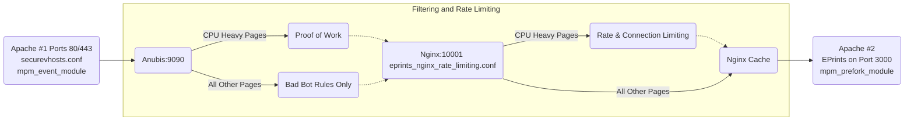
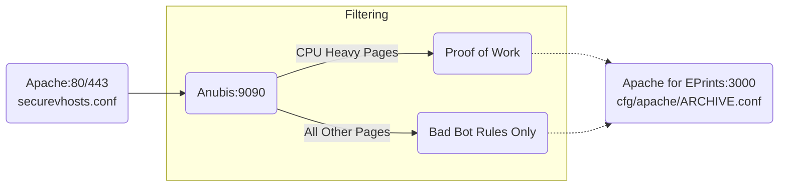

# Anubis Configuration Support

**This is still experimental, use at your own risk**

Anubis is an open source project which attempts to block web scrapers. It behaves as a reverse proxy, deciding whether to forward on requests to the service being protected or block them. EPrints is susceptible to being taken offline by swarms of AI bots which are indistinguishable from a DDOS attack. The CPU heavy search and statistics pages can very easily be overwhelmed and take an entire repository offline.

The default configuration aims to reach a balance between being as open as possible - we should like to allow well behaved scrapers to index EPrints - but blocking the worst bots to prioritise staying online.

Multiple repositories on the same host (with their own virtualhosts) is supported.

## Rate Limiting and Caching With Nginx

Even with Anubis configured some repositories have still experienced extremely heavy CPU load and been taken offline. An experimental rate and connection limiting and caching config for nginx is available. This enables a cache for non-logged in users accessing CPU heavy pages, and also limits for requests per IP and overall.

The caching should be able to make a significant improvement in response times when under heavy load from some of the stranger bot swarms which make thousands of identical requests. In order to support caching, some minor changes are required to how EPrints uses cookies to store login sessions. The fixes are contained in z_fix_cookies.pl.disabled and this should be symlinked into the archive until this is fixed in EPrints core - hopefully in EPrints 3.4.8. You will also need to create the folder structure for the cache, and configure it in selinux. The idea behind having the cache folders owned and writable by the eprints user is so we could easily add admin tools for clearing the cache, if required.

```
ln -s /opt/eprints3/ingredients/anubis/cfg.d/z_fix_cookies.pl.disabled /opt/eprints3/archive/YOUR_ARCHIVE/cfg/cfg.d/z_fix_cookies.pl

mkdir -p /opt/eprints3/var/cache/nginx/cpu_heavy_cache
mkdir -p /opt/eprints3/var/cache/nginx/everything_else_cache

sudo semanage fcontext -a -t httpd_cache_t "/opt/eprints3/var/cache/nginx/cpu_heavy_cache(/.*)?"
sudo semanage fcontext -a -t httpd_cache_t "/opt/eprints3/var/cache/nginx/everything_else_cache(/.*)?"

sudo restorecon -Rv /opt/eprints3/var/cache/nginx/cpu_heavy_cache
sudo restorecon -Rv /opt/eprints3/var/cache/nginx/everything_else_cache
```

Nginx listens on port 10001, behind Anubis and in front of EPrints. It will limit rates globally and per-IP and limit the maximum number of simultanious connections to CPU heavy pages (configurable). When limits have been reached, an HTTP 503 is sent, with a page explaining which feature is temporarily offline. This should keep a lid on the maximum CPU usage and enable EPrints to stay alive, even if search, stats, and export functionality stops working.  The default configuration is intended to allow all connections through under normal load, and start blocking connections (responding with a page saying "[repo name] is under heavy load and [feature] is temporarily unavailable. Please try again later.") only when necessary to keep the server online and responding in a timely manner to other requests.

Run `/opt/eprints3/ingredients/anubis/bin/generate_apacheconf_for_anubis --ratelimit` to configure Apache to forward to nginx and override the default HTTP 503 behaviour.

Copy `/opt/eprints3/ingredients/anubis/rate_limiting/eprints_nginx_rate_limiting.conf` to `/opt/eprints/archives/[ARCHIVE ID]/nginx/eprints_nginx_rate_limiting.conf` where you can make archive specific changes. Then make sure that this is included in nginx. For caching to work, you will need to make nginx run as the user and group eprints. On Red Hat you will want to remove the `server {}` block in `/etc/nginx/nginx.conf` and create `/etc/nginx/conf.d/eprints.conf` with the content:

```
include /opt/eprints3/archives/[YOUR ARCHIVE ID]/nginx/*.conf;
```

On most other distros you will want to remove `/etc/nginx/sites_enabled/default` and create `/etc/nginx/sites_enabled/eprints.conf` with the above content instead.

Note that the occasional segfaults (presumed to be caused by lack of thread safety and mpm_event) from Apache running EPrints cause greater issues when behind an Nginx proxy. So two instances of Apache are used - one in front using mpm_event and one for eprints using mpm_prefork. If we can find a way to use Shibboleth without apache, we can use nginx in front.

## TODO List
 - Error message from generate_apacheconf_for_anubis or support for HTTP (no ssl) or HTTP & HTTPs with no HTTP->HTTPS redirect.

## How to configure

Note these instructions were written assuming RHEL. For other distros exact details will vary. Notably the name of the apache service ('httpd' on RHEL).

### Just Anubis

1. Ensure EPrints is currently configured to use SSL in the standard way [as per the wiki](https://wiki.eprints.org/w/How_to_use_EPrints_with_HTTPS) with the SSL configuration in archive/*/ssl/securevhost.conf
2. Install Anubis. [Anubis official install guide](https://anubis.techaro.lol/docs/admin/native-install/). Official deb and RPM files are available.
3. Install this ingredient: 
   1. `cd /opt/eprints3/ingredients`
   2. `git clone https://github.com/eprints/anubis.git`
   3. `git checkout v0.6` (or whichever release your desire)
   4. `echo "ingredients/anubis" >> /opt/eprints3/flavours/pub_lib/inc` (enables the ingredient)
4. Copy `/opt/eprints3/ingredients/anubis/anubis_config/eprints.botPolicies.yaml` to `/opt/eprints3/archives/[YOUR ARCHIVE ID]/anubis/eprints.botPolicies.yaml`
   - Alternatively use `eprints_permissive.botPolicies.yaml` which only blocks known bad bots and otherwise won't do any proof of work
5. Create `/etc/anubis/eprints.env` with: 
```BIND=:8923
DIFFICULTY=4
METRICS_BIND=[::1]:9090
METRICS_BIND_NETWORK=tcp
SERVE_ROBOTS_TXT=0
TARGET=http://[::1]:3000
POLICY_FNAME=/opt/eprints3/archives/[YOUR ARCHIVE ID]/anubis/eprints.botPolicies.yaml
```
6. Enable and start systemd module for anubis for EPrints: `sudo systemctl enable --now anubis@eprints.service`. Do not proceed further until the anubis service is running!
7. Run `/opt/eprints3/ingredients/anubis/bin/generate_apacheconf_for_anubis` to update EPrints apache config files to set up the Anubis proxy
8. Confirm `/opt/eprints3/archives/[YOUR ARCHIVE ID]/ssl/securevhost.conf` is correct. In most circumstances it shouldn't need editing:
   1.  It should already `Include /opt/eprints3/cfg/apache_ssl/[YOUR ARCHIVE ID].conf` which is now the anubis configuration rather than EPrints.
   2.  Note that if you have any SSL aliases, you may have to re-configure the SSL redirects yourself in this file.
   3.  An example SSL config file using Lets Encrypt is provided in `/opt/eprints3/ingredients/anubis/ssl/securevhost.conf.example` for reference. 
9.  Restart apache: `sudo systemctl restart httpd` 

If you need to revert the apache config changes use `/opt/eprints3/ingredients/anubis/bin/generate_apacheconf_for_anubis --undo`

Note that I recommend disabling any rate-limiting that mod_security may be performing as I'm not sure how this interacts with Anubis.

### Anubis and Ningx

Perform steps 1-5 above, then:

1. Run `/opt/eprints3/ingredients/anubis/bin/generate_apacheconf_for_anubis --ratelimit` to update EPrints apache config files to set up the Anubis proxy
2. Configure nginx (however you wish - this varies massively depending on linux distro) to NOT listen on port 80 or 443, and load /opt/eprints3/cfg/nginx/*.conf
3. Edit `/etc/anubis/eprints.env` to target port 10001 (nginx in front of EPrints).
4. Restart nginx, anubis and apache: `sudo systemctl restart httpd nginx anubis@eprints`.
5. For EPrints 3.4.7 and below, symlink in the fixes for EPrints core. See [details for what these fixes do](#eprints-core-fixes) 
   1. `ln -s /opt/eprints3/ingredients/anubis/cfg.d/z_fix_apacheconf.pl.disabled /opt/eprints3/archive/ARCHIVEID/cfg/cfg.d/z_fix_apacheconf.pl`
   2. `ln -s /opt/eprints3/ingredients/anubis/cfg.d/z_fix_cookies.pl.disabled /opt/eprints3/archive/ARCHIVEID/cfg/cfg.d/z_fix_cookies.pl`

### Additional stability for EPrints

EPrints segfaults occasionally when apache is configured to use mpm_event (multithreaded mode). EPrints is stable with mpm_prefork. Therefore to run a separate instance of apache purely for EPrints use the following steps:

1. Delete`/etc/httpd/conf.d/eprints.conf` (so the default apache instance isn't running EPrints)
2. Reload httpd so it's not listening on port 3000: `sudo systemctl reload httpd`
3. Symlink new systemd service module 'httpd-eprints' `sudo ln -s /opt/eprints3/ingredients/anubis/systemd/httpd-eprints.service /etc/systemd/system/httpd-eprints.service` 
4. Load new systemd service file `sudo systemctl daemon-reload`
5. Enable and run httpd-eprints `sudo systemctl enable httpd-eprints --now`

Now the front-facing web server (httpd) is in multithreaded mode and able to handle a large number of connections. EPrints is not, but won't see nearly as many connections due to the layers in front.

The long term plan is to have nginx as the front facing webserver so it can handle a large number of open connections. Until Shibboleth can be demonstrated working with this, Apache remains the front facing webserver.

### EPrints Core Fixes

`z_fix_apacheconf.pl` and `z_fix_cookies.pl` patch core code to simplify cookie names and re-arrange the apache configuration. Cookie names previously had the hostname in the name of the cookie and weren't deleted when logging out - making configuring the cache harder. The perl handler was previously configured in securevhost.conf and is now in the archive configuration.

The aim is for these fixes to be included in core code for the next releases of EPrints (3.4.8 and 3.5.1).

## Diagrams

### With Rate Limiting and Caching using Nginx


### Without Nginx


## How to confirm this is working

Open a new browser, or an incogneto window in a browser and navigate to your repository's search page. When first loading the search page you should briefly see the anubis logo pop up.

Log in as an administrator and navigate to the Admin page. Under "System Tools" there should be a new button "Anubis Status". This page will report Anubis' metrics. Note that the metrics are the current cumulative total. Future work could including some way of logging and graphing these metrics to keep an eye on Anubis.

## How to unconfigure

If anything has gone wrong, or for whatever reason you need to remove anubis, you can run:
`/opt/eprints3/ingredients/anubis/bin/generate_apacheconf_for_anubis --undo`

This will put EPrints' Apache config back to how it was before. Anubis will still be running as a service in the background, but Apache will not be routing any traffic through it.

## SELinux

Run `sudo ./redeploy_policy.sh` to install the SELinux policy which should allow Apache to reach the status page of Anubis, and Nginx to manage its cache.

For more help generating SELinux rules [the redhat docs](https://docs.redhat.com/en/documentation/red_hat_enterprise_linux/6/html/security-enhanced_linux/sect-security-enhanced_linux-fixing_problems-allowing_access_audit2allow) are very useful.

## Common Custom Anubis Rules

In `/opt/eprints3/archives/[YOUR ARCHIVE ID]/anubis/eprints.botPolicies.yaml` the default Anubis bot list is used and a proof-of-work check is enabled only for stats and search. Export may also need to be covered, we are still experimenting with the best policy.

# Anubis IP Whitelist

The remote_addresses argument expects CIDR notation, for a single IP use "/32".

```
- name: ip-whitelist
    action: ALLOW
    remote_addresses:
      [
        "152.78.x.x/32"
      ]
```
